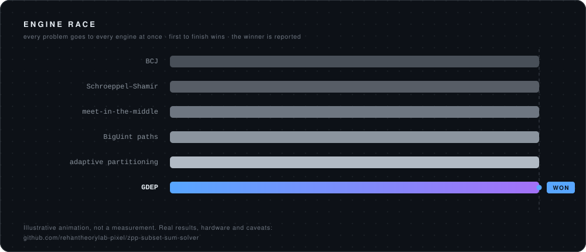

<div align="center">


<br>

<a href="https://github.com/rehantheorylab-pixel/zpp-subset-sum-solver">
  
</a>

<br><br>

[](https://github.com/rehantheorylab-pixel/zpp-subset-sum-solver)
[](https://github.com/rehantheorylab-pixel/browser-bridge-for-muse)
[](https://github.com/rehantheorylab-pixel/maik)

<br>

**Rehan Theory Lab**  ·  [rehan@rehantheorylab.com](mailto:rehan@rehantheorylab.com)  ·  Open to remote contracts

</div>

---

<div align="center">

</div>

I work on two hard problems at once: making **exact computation faster** — NP-complete search,
kernel-level memory management — and making it **safe for AI agents to operate real machines**,
through bridges with an explicit consent model.

---

## What I'm building

<table>
<tr>
<td width="50%" valign="top">

#### [Z++ — exact subset-sum solver](https://github.com/rehantheorylab-pixel/zpp-subset-sum-solver)

Races **49 engines** against each other — published baselines and original work
competing on the same problem — and reports which one won. You get the answer, plus
the evidence for *why* that class of technique solved that class of instance.

```yaml
baselines:  Schroeppel–Shamir · MITM · BCJ · HGJ · Bonnetain
original:   GDEP · adaptive core-aware partitioning · BigUint
measured:   n=60 → 524 s  (i3-2100)     = 1,649× vs BCJ
projected:  n=60 → 24.3 s (Ryzen 9)     = 35,556×
memory:     ~12 GB floor at n=60
```

</td>
<td width="50%" valign="top">

#### [browser-bridge-for-muse](https://github.com/rehantheorylab-pixel/browser-bridge-for-muse)

Gives an AI agent access to the user's **own** browser and desktop — the sessions they
already have — instead of a sterile browser that hits a login wall on every site.
User-initiated, visible, killable.

```yaml
engines:    Chrome profile · CDP · patched driver
interface:  MCP server
consent:    per-session opt-in, visible, scoped
never:      credential export, silent operation
```

</td>
</tr>
<tr>
<td width="50%" valign="top">

#### [MAIK — Multi-Agent Intelligence Kernel](https://github.com/rehantheorylab-pixel/maik)

An agent system organised as a company: identities, managers, notebooks, scoped
permissions, and prompts generated at runtime from each node's own context. Failures
demote the route that caused them.

```yaml
structure:  CEO → manager → agent → sub-agent
routing:    domain → model, chosen from grades
execution:  mouse, keyboard, screen, browser
status:     research prototype — graders are internal
```

</td>
<td width="50%" valign="top">

#### [ZPP Unix](https://github.com/rehantheorylab-pixel/zpp_unix)

A RISC-V kernel extended with **lock-free, arena, and slab allocators** integrated into
an existing memory subsystem. A fork of caffeinix, credited as such in the first line.

```yaml
upstream:   caffeinix · Troy Mitchell · GPL-3.0
added:      lock_free.c · arena.c · slab.c · palloc.c
scope:      ~390 lines into a ~7,500-line kernel
```

</td>
</tr>
</table>

---

## How I work

> **Measure, then claim.** Every number I publish carries the machine it ran on and whether
> it was measured or projected. A ratio computed from two estimates is labelled an estimate.

> **Credit upstream.** A fork says what it is forked from in the first line. Attribution is a
> licence obligation under GPL, and a credibility requirement under everything else.

> **State the limit.** If it isn't tested, the README says so before the reader finds out.
> Limitations sections are cheaper than retractions.

---

## Currently

- Running the head-to-head my benchmarks currently admit is missing: Z++ against published
  baselines, **same machine, same inputs**
- Measuring **thread-count scaling** on the partitioning design — testing whether it holds
  linear, or better, as core count rises
- Keeping the browser bridge's consent model ahead of its capabilities

---

## Stack

<div align="center">


`allocators` · `page tables` · `trap handling` · `branch & bound` · `meet-in-the-middle` ·
`CDP` · `MCP` · `Chrome extensions` · `QEMU/gdb`

</div>

---

## Elsewhere

<div align="center">

[](https://orcid.org/0009-0003-8748-6524)
[](https://doi.org/10.5281/zenodo.20399806)
[](https://huggingface.co/12rehdsa)

</div>

---

<div align="center">

**Working on something that needs exact search, kernel work, or agent tooling?**
[rehan@rehantheorylab.com](mailto:rehan@rehantheorylab.com)

<sub><a href="https://github.com/rehantheorylab-pixel">github.com/rehantheorylab-pixel</a></sub>

</div>
